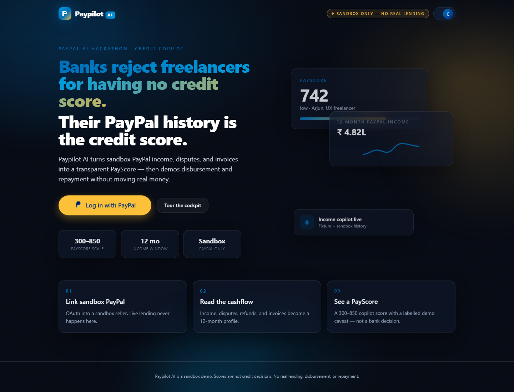

# Paypilot AI UI

Responsive React 18 + Vite frontend for the Paypilot AI hackathon demo. The app uses Framer Motion for transitions and interactions, Tailwind for the visual system, lazy-loaded route chunks, keyboard-visible focus styles, and `prefers-reduced-motion` through Framer Motion's user setting and CSS.

## Run locally

1. Start the FastAPI service from the repository root using the backend setup in `README.md`.
2. Configure PayPal sandbox credentials in the backend `.env` if you want OAuth and sandbox API calls. Use the documented development defaults for local fixture mode.
3. From `frontend/`, run `npm install` then `npm run dev`.
4. Open the Vite URL. Select **Tour the cockpit** (or **Start demo** on Overview) to load synthetic Priya fixture data.

## Demo-mode walkthrough (3 minutes)

1. **Login** — choose Tour the cockpit. This selects the explicitly synthetic Priya persona without OAuth.
2. **Income** — review the 12-month income summary, trend and gap, chart, and synthetic fixture transaction table.
3. **PayScore** — run the score to see the API result, eligibility ceiling, risk band, and heuristic drivers. They are explicitly not SHAP values.
4. **Offer guard** — enter an advertised APR and fee, attach a local screenshot/PDF if desired, and inspect the fee-adjusted estimate and checklist. The current API accepts typed terms; file contents are not uploaded or parsed.
5. **Copilot** — ask “Can I afford ?50k?” The reply includes an approval card. Decline does nothing; Approve calls the sandbox disbursement API and still requires an eligible score and amount within its ceiling.
6. **Repayment** — create a fixed EMI schedule or set revenue share. The one-off order endpoint returns the PayPal JS SDK v6 `orderId` shape; checkout needs PayPal sandbox browser configuration. Poll payout status with the batch id returned by the copilot.
7. **AG Studio** — add “show my income by client” to spawn a widget. The API only provides synthetic categories here, not client identities; the widget states that limitation.

## Routes

- `/` landing page, PayPal OAuth login, and demo entry
- `/app` Overview
- `/app/income` income profile
- `/app/score` explainable score
- `/app/offer-guard` offer cost check
- `/app/copilot` approval-gated copilot
- `/app/repay` repayment modes and payout polling
- `/app/cockpit` AG Studio widgets

## Data and demo limits

The backend demo APIs use sandbox credentials and synthetic fixtures. No live lending decision or real disbursement is made. The linked PayPal income endpoint returns aggregate profile values, so the live transaction table is not represented as actual transaction data. The current offer guard calculates an estimate from manually entered fields and cannot OCR attached files. Score drivers returned by the current backend are heuristic, not SHAP. The income chart is a small native SVG implementation; transaction rows use a responsive accessible HTML table. Recharts and AG Grid could not be installed in this environment because the npm registry was unreachable, so this build has no unresolved package imports.

## Screenshots

### Landing page

Capture the feature screens from `npm run dev` with the API running before using them in the submission video/deck.
