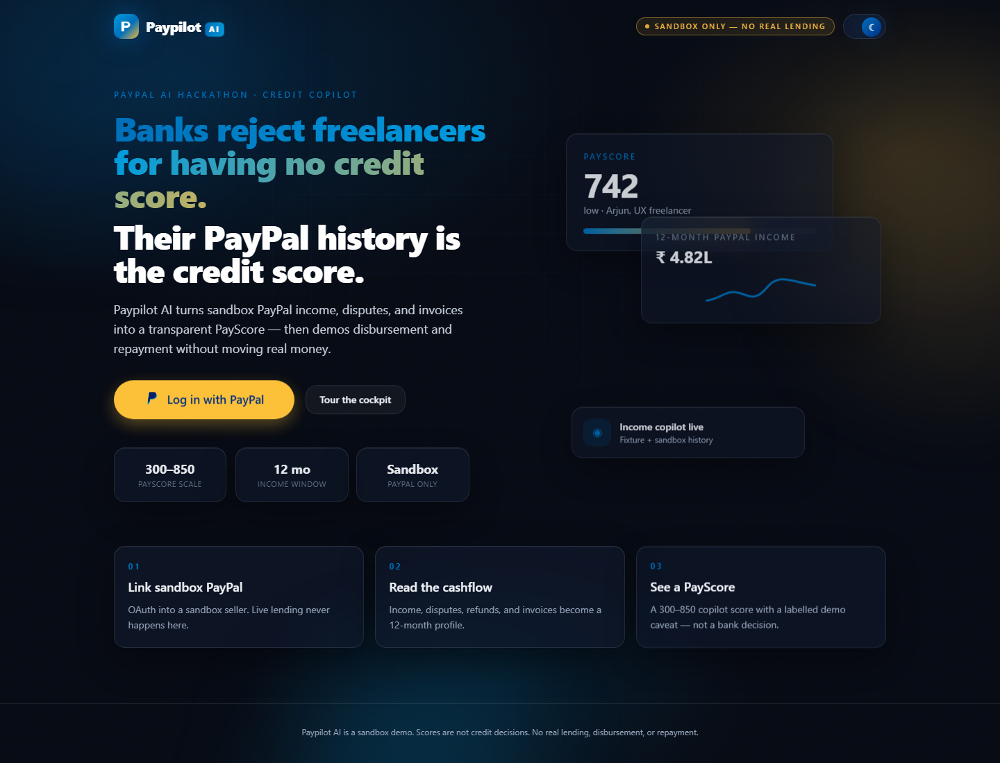
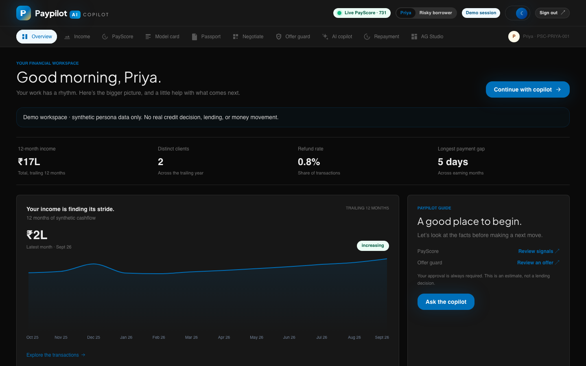
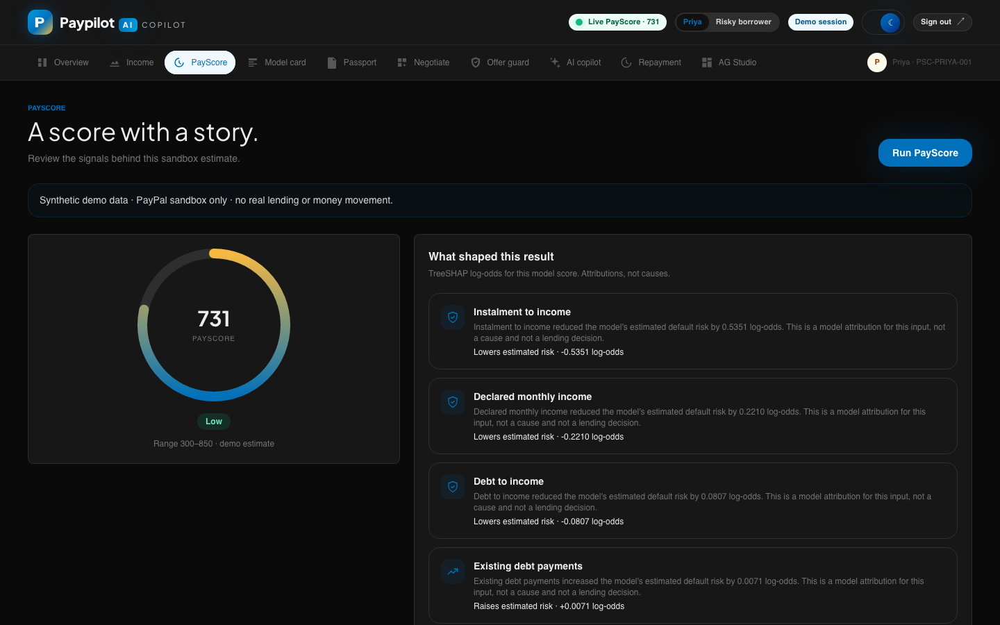
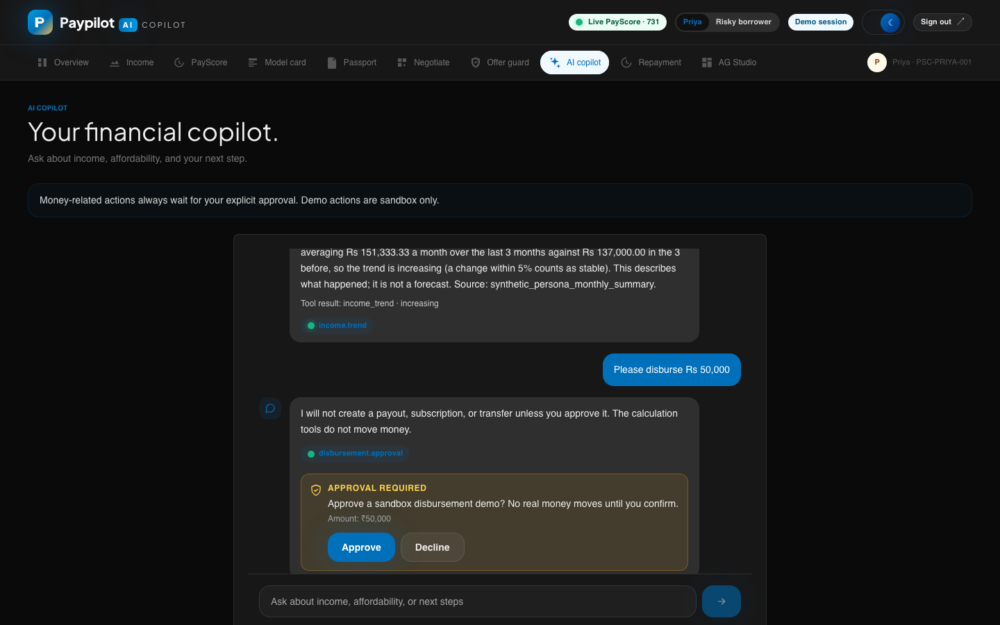
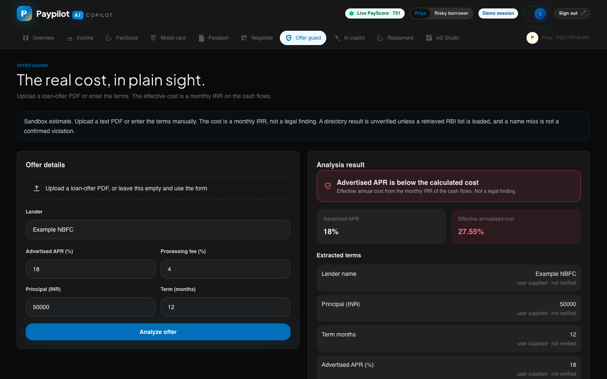
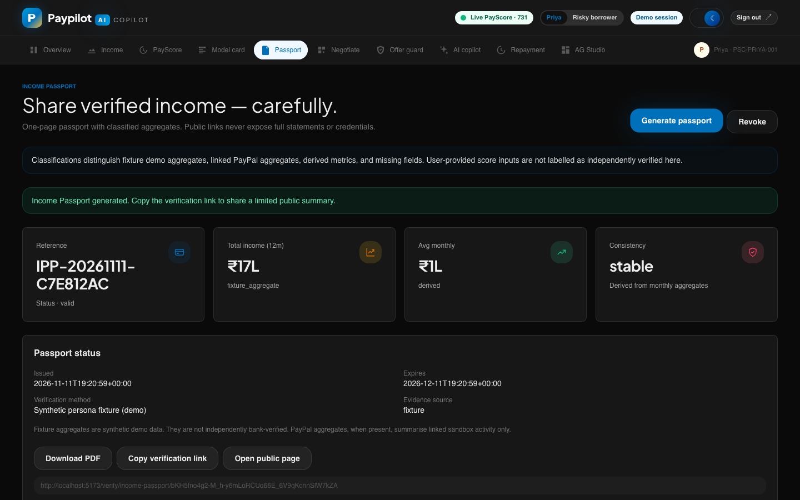

# Paypilot AI — PayScore

A cash-flow credit copilot for India's online sellers and freelancers. PayScore reads 12 months of PayPal income,
explains a 300–850 score, catches loan offers that hide their real cost, and keeps every money movement behind
explicit borrower approval. **Sandbox only:** synthetic personas, PayPal sandbox, no real lending.

## For judges

* **Watch the demo:** https://youtu.be/S6RLEg1N8mg (2 min 50 s, with voiceover)
* **Try it live:** https://paypilot-ai-chi.vercel.app

[](https://youtu.be/S6RLEg1N8mg)

### Screenshots

| | |
|---|---|
|  |  |
| **Landing:** log in with PayPal or try a demo persona | **Overview:** 12 months of income at a glance |
|  |  |
| **PayScore:** a 300–850 score with TreeSHAP drivers | **AI copilot:** real tools, and payouts wait for approval |
|  |  |
| **Offer Guard:** the real annual cost behind an advertised rate | **Income Passport:** shareable proof of income, revocable |

No login is needed. Open either link to land in the demo workspace as that persona:

| Persona | Link | Committed-model score |
|---|---|---|
| Priya Nair, stable online seller | https://paypilot-ai-chi.vercel.app/try/priya | 731 (low risk) |
| Rohan Kulkarni, risky borrower | https://paypilot-ai-chi.vercel.app/try/rohan | 465 (high risk) |

The landing page has the same two buttons, and the top bar has a toggle to switch persona mid-demo. Switching clears
the previous persona's score, offer, and payout state.

Things to try:

1. **PayScore:** run the score, then read the TreeSHAP drivers and the eligible changes that would raise it.
2. **Offer Guard:** enter or upload a loan offer to compare the advertised APR with the IRR of the cash flows. Then use
   **Is PayPal Pay Later cheaper?** to price the same purchase with PayPal Pay Later. PayPal does not offer Pay Later
   in India, so INR purchases report it as unavailable. Choose the US market to see Pay in 4 and Pay Monthly priced
   from PayPal's published terms.
3. **AI copilot:** ask "Can I afford ₹50k?" or "Please disburse Rs 50,000". Payouts wait for an explicit Approve.
4. **Income Passport:** generate one, open its public verification page, then revoke it.
5. **AG Studio:** type "show my income by client" or "show my score drivers" to add live widgets.
6. **Model card, Negotiation, Repayment:** under the matching nav items.

### Log in with PayPal (your own sandbox account)

**Log in with PayPal** on the landing page links a PayPal sandbox account through OAuth (PKCE). Paypilot never sees the
password, and the token can only read transaction history, disputes, and invoices. Once linked, every screen reads that
account instead of a demo persona:

* **Overview and Income** show the account's own 12-month income. An account with no sales says so; it is never filled
  with demo figures.
* **PayScore** asks only for what PayPal does not share (age, employment, the loan you want, and optionally a declared
  income). `POST /score/linked` combines that with the PayPal history and labels every model input as *from PayPal*,
  *from you*, or *not available*.
* **AI copilot** answers affordability, income trend, and score questions from the linked account. It never offers a
  payout for a linked account, because PayPal sign-in does not share a verified payout email.

The link lives in an encrypted, HttpOnly cookie in that browser only. A server never uses one browser's PayPal account
for another visitor, and switching to a demo persona unlinks it.

### Deploy the demo

`render.yaml` is a Render Blueprint for both services: the API (`payscore-ai-api`) and the static frontend
(`paypilot-web`). In Render, choose **New → Blueprint** and point it at this repo, then set the PayPal sandbox secrets
in the dashboard. The Blueprint wires each service to the other's default `onrender.com` URL. If Render assigns
different names, update `VITE_PAYSCORE_API_URL` and `PAYSCORE_CORS_ORIGINS` to match.

## Run locally on Windows, macOS, or Linux

**Prerequisites**

| | Version | Notes |
|---|---|---|
| Python | 3.10 or newer (tested on 3.12) | `python.org` installer on Windows; tick "Add python.exe to PATH" |
| Node.js | 20.19+ or 22.12+ (22 LTS recommended) | Required by Vite 8 |
| macOS only | `brew install libomp` | LightGBM needs the OpenMP runtime |
| Windows only | [Visual C++ Redistributable (x64)](https://aka.ms/vs/17/release/vc_redist.x64.exe) | LightGBM needs `VCOMP140.dll` |
| Linux only | `libgomp1` (preinstalled on most distros) | LightGBM's OpenMP runtime |

**One command.** It creates `.venv`, installs Python and npm dependencies on first run, starts the API and the
frontend, and prints the demo links. Ctrl+C stops both.

```bash
python3 scripts/dev.py        # macOS / Linux
py scripts\dev.py             # Windows (PowerShell or cmd)
```

No `.env` is needed: without PayPal credentials, payouts, subscriptions, and checkout run in a clearly labelled simulated mode (ids start with `SIM-`, no PayPal call). To use the real PayPal sandbox, run `python3 scripts/configure_paypal.py`, or copy `.env.example` to `.env` and fill in section 1.

**Manual setup.** Only the virtual-environment activation differs by shell:

| Shell | Activate `.venv` |
|---|---|
| bash / zsh (macOS, Linux, Git Bash) | `source .venv/bin/activate` |
| fish | `source .venv/bin/activate.fish` |
| PowerShell | `.venv\Scripts\Activate.ps1` |
| cmd | `.venv\Scripts\activate.bat` |

```text
python -m venv .venv            # then activate it as above
pip install -r requirements.txt
uvicorn payscore.api:app --port 8000
cd frontend && npm install && npm run dev      # in a second terminal
```

If PowerShell refuses to run `Activate.ps1`, run `Set-ExecutionPolicy -Scope CurrentUser RemoteSigned` once.

## CLI and MCP server

The same analysis is available without the web app. Both are installed into `.venv` by `scripts/dev.py`:

```bash
paypilot score rohan
paypilot offer --apr 18 --fee 4 --principal 50000 --months 12
paypilot pay-later --amount 1200 --market US --apr 18 --fee 4 --months 12
claude mcp add paypilot -- /path/to/Paypilot-AI/.venv/bin/paypilot-mcp    # MCP for Claude Code
```

Ten read-only tools (score, what-if, income, offer and PDF checks, Pay Later, affordability, copilot, model card). Nothing
moves money. Commands, tools, and client setup for Claude Desktop, Cursor, and Arka:
[docs/CLI_AND_MCP.md](docs/CLI_AND_MCP.md).

## Repository layout

```text
payscore/        FastAPI app and all backend logic (scoring, offers, copilot, passport, negotiation)
                 cli.py (paypilot command), mcp_server.py (MCP server), tools.py (shared by both)
  paypal/        PayPal sandbox client, income, disbursements, repayment, webhooks
frontend/        React + Vite app (see frontend/README.md)
tests/           pytest suite
fixtures/        synthetic personas and the demo prompt-injection PDF
models/          committed LightGBM model and its metadata
schema/          JSON schemas for personas and score requests
reference/       RBI digital-lending snapshot used by Offer Guard
scripts/         end-to-end smoke tests against a running API
docs/            all documentation (index: docs/README.md)
render.yaml      Render Blueprint for the API and the frontend
```

## Developer reference

The sections below are the original engineering notes, starting with the Week 1 AI component.

Early, **development-only** credit-scoring baseline for small online sellers/freelancers.
Everything runs on **synthetic / normalised data**. No PayPal API is called, no money moves, and the
score must not be used for real lending decisions.

## What is here

| Path | Purpose |
|---|---|
| `payscore/schema.py` | Pydantic input/output contract (`ScoreRequest`, `ScoreResponse`), all amounts in INR |
| `payscore/features.py` | Feature engineering shared by training and inference (single code path) |
| `payscore/synthetic.py` | **Synthetic** development dataset generator (seeded) |
| `payscore/homecredit.py` | Optional loader for Kaggle *Home Credit Default Risk* `application_train.csv` (data not included) |
| `payscore/train.py` | LightGBM training + metadata, plus a logistic-regression context baseline |
| `payscore/model.py` | Model loading, PD -> 300-850 score mapping, risk bands, labelled dev fallback |
| `payscore/predict.py` | CLI scoring of a JSON file |
| `payscore/api.py` | FastAPI app: `GET /health`, `POST /score` |
| `payscore/paypal/seed.py` | Dry-run-by-default CLI to seed PayPal sandbox from persona fixtures |
| `payscore/derive.py` | Reference derivation: transaction history -> model-input metrics |
| `payscore/build_fixtures.py`, `export_schema.py` | Regenerate persona fixtures / JSON Schemas |
| `models/` | Trained artifact (`payscore_lgbm.txt`) + `model_metadata.json` |
| `schema/` | `score_request.schema.json`, `persona.schema.json` |
| `fixtures/personas/` | 3 fictional personas (Priya, Arjun, Rohan) with transactions + `model_input` |
| `docs/` | `INTEGRATION.md`, `FEATURE_MAPPING.md`, `MODEL_CARD.md`, `PERSONAS.md`, `SEEDING.md` |
| `tests/` | pytest suite |

## Quick start (Python 3.10+; developed on 3.12)

```bash
pip install -r requirements.txt
python -m pytest -q                                   # run tests
python -m payscore.predict --input fixtures/personas/priya.json
uvicorn payscore.api:app --port 8000                  # then open http://localhost:8000/docs
python -m payscore.train                              # retrain on synthetic data (seed 42)
python -m payscore.build_fixtures && python -m payscore.export_schema   # regenerate fixtures/schemas
```

```bash
# bash/zsh only. On any OS, http://localhost:8000/docs can send the same request from the browser.
curl -s localhost:8000/score -H 'Content-Type: application/json' \
  -d @<(python -c "import json;print(json.dumps(json.load(open('fixtures/personas/priya.json'))['model_input']))")
```

## Score and risk bands

`probability_of_default` -> score = 600 + (50/ln 2)·ln(odds/12), clipped to **300-850** (600 pts = 12:1 good:bad odds, +50 pts doubles the odds).

| Score | Band |
|---|---|
| >= 720 | low |
| 650-719 | moderate |
| 560-649 | elevated |
| < 560 | high |

## API behaviour

* `422` `{"error":"validation_error","detail":[{field,message,type}]}` — invalid input; submitted values are **not** echoed back.
* `503` — no trained model and `PAYSCORE_ALLOW_FALLBACK=false`.
* If the model artifact is missing and fallback is allowed, a deterministic rule-of-thumb formula is used and is
  labelled `development_fallback` / `is_trained_model: false` in every response.
* Corrupt/incompatible artifacts fail loudly at start-up (never silently replaced by the fallback).
* CORS: local dev origins only by default (`PAYSCORE_CORS_ORIGINS`). See `.env.example`.

## Honest limitations (read before demoing)

1. The shipped model is trained on **synthetic data** whose labels come from a hand-written risk rule + noise.
   The reported test ROC-AUC of **0.848** comes from a split of that synthetic data. It only shows the pipeline works;
   it is **not** evidence of real-world credit-risk accuracy and is **not** a Home Credit or PayPal benchmark.
2. The Home Credit loader maps **6 of the model's 16 input columns, plus the ID**: `age_years`, `employment_type`,
   `monthly_income_inr`, `requested_loan_amount_inr`, `requested_term_months`, and `business_age_months` (only a proxy,
   derived from employment length). The other 10 inputs stay empty, and amounts are not converted to INR. It has only been
   tested on a small mock CSV; no real Home Credit data was used. A model trained on it would be weak on this problem and
   must not be described as validated on PayPal-style inputs.
3. No fairness/bias analysis or calibration on real outcomes. Score explanations are TreeSHAP attributions from the trained model, not causal claims. See the Week 2 and Week 3 section below.
4. Persona narratives are scenarios, not ground truth: the model is not tuned to match the stories. Measured scores are
   Priya 771 (*low*), Arjun 742 (*low*), Rohan 533 (*high*); ordering (Priya > Arjun > Rohan) is asserted in tests.
5. **All PayPal field mappings are PROVISIONAL and UNVERIFIED.** No PayPal API or sandbox was consulted or called; see the
   placeholder table in `docs/FEATURE_MAPPING.md`.

## Reference scores (committed model, committed fixtures)

| Persona | Score | Band | PD |
|---|---|---|---|
| Priya (stable seller) | 731 | low | 0.013 |
| Arjun (lumpy freelancer) | 727 | low | 0.014 |
| Rohan (thin history, big loan) | 465 | high | 0.35 |

## Setup, run, test (exact commands)

```bash
python -m venv .venv && source .venv/bin/activate     # other shells: see "Run locally" above
pip install -r requirements.txt
python -m payscore.train                              # optional: retrain (WRITES ./models by default; use --out-dir to avoid overwriting)
python -m payscore.predict --input fixtures/personas/priya.json
uvicorn payscore.api:app --port 8000
python -m pytest -q
ruff check .
```

Reproducibility (checked, with limits): retraining with the defaults (seed 42, `num_threads=1`) into a temporary directory produced a
`payscore_lgbm.txt` byte-identical to the committed one, in repeated runs and under two library sets (lightgbm 4.7.0 with
scikit-learn 1.8.0/pandas 3.0.2/numpy 2.4.4, and with scikit-learn 1.9.1/pandas 3.1.0/numpy 2.5.4), on Linux x86_64, Python 3.12.3.
`model_metadata.json` is **not** byte-identical because it records `trained_at_utc`; every other field matched. Other
platforms, Python versions or LightGBM versions were **not** tested, so do not assume identical output there.

Real Home Credit data (optional, **not** included, **not** run here): get `application_train.csv` from Kaggle (needs an account and
acceptance of the competition rules; check them for permitted use), then
`python -m payscore.train --source homecredit --homecredit-path /path/to/application_train.csv --out-dir models_hc`.
It never downloads anything.

## Environment variables (see `.env.example`; no secrets are needed)

| Variable | Default | Meaning |
|---|---|---|
| `PAYSCORE_MODEL_DIR` | `./models` | Directory with `payscore_lgbm.txt` + `model_metadata.json` |
| `PAYSCORE_ALLOW_FALLBACK` | `true` | Serve the labelled development fallback when no model exists (`false` -> 503) |
| `PAYSCORE_CORS_ORIGINS` | `http://localhost:3000,http://localhost:5173` | Allowed origins; `""` disables CORS; `*` allows all (avoid) |
| `PAYSCORE_FRONTEND_URL` | empty | Public frontend origin used in Income Passport PDF verification links (trailing slash stripped) |
| `PAYSCORE_PASSPORT_SIGNING_KEY` | empty | Optional HMAC-SHA256 key for Income Passport content integrity; leave empty to skip content signatures |

## Example requests and responses (captured from a live `uvicorn` run)

`GET /health`
```json
{"status":"ok","model_loaded":true,"development_fallback_active":false,"model_type":"lightgbm","model_version":"0.1.0-synthetic-seed42","api_version":"0.1.0"}
```

`POST /score` with Priya's `model_input` -> `200`
```json
{
  "applicant_id": "PSC-PRIYA-001", "score": 771, "score_range": {"min": 300, "max": 850}, "risk_band": "low",
  "probability_of_default": 0.0077,
  "model": {"name": "payscore-lgbm-baseline", "version": "0.1.0-synthetic-seed42", "type": "lightgbm",
            "is_trained_model": true, "training_data": "synthetic_development_dataset"},
  "evaluation_caveat": "Model trained on a SYNTHETIC development dataset, not real Home Credit or PayPal data. Scores are for demonstration and integration testing only; not for real lending decisions.",
  "missing_inputs": []
}
```

Invalid body `{"applicant_id":"X1","age_years":15,"employment_type":"pilot","requested_term_months":0}` -> `422`
```json
{"error":"validation_error","detail":[
 {"field":"age_years","message":"Input should be greater than or equal to 18","type":"greater_than_equal"},
 {"field":"employment_type","message":"Input should be 'salaried', 'self_employed', 'freelancer', 'business_owner' or 'other'","type":"enum"},
 {"field":"monthly_income_inr","message":"Field required","type":"missing"},
 {"field":"requested_loan_amount_inr","message":"Field required","type":"missing"},
 {"field":"requested_term_months","message":"Input should be greater than or equal to 1","type":"greater_than_equal"}]}
```

With no model artifact (development fallback, all responses say so): `model.type` = `"development_fallback"`,
`is_trained_model` = `false`, caveat starts `DEVELOPMENT FALLBACK: ... NOT a trained-model prediction`. Fallback scores for the
personas: Priya 701 (moderate), Arjun 679 (moderate), Rohan 446 (high) - hand-set heuristic, not a model.

## Team handoff

See `docs/INTEGRATION.md` (how to call the API, provisional fields, frontend URL, implemented vs pending),
`docs/FEATURE_MAPPING.md` (field spec + PayPal placeholder table) and `docs/MODEL_CARD.md`.

## E2E smoke test (test freeze, before Nov 8)

`scripts/e2e_smoke.py` runs the full Person-2 flow against a deployed Render backend:

```bash
export PAYSCORE_API_URL=https://payscore-ai-api.onrender.com
export RUN_ADVANCE=1          # optional: enable invoice-advance (2.8) steps
# PowerShell: $env:PAYSCORE_API_URL = "https://payscore-ai-api.onrender.com"; $env:RUN_ADVANCE = "1"
python scripts/e2e_smoke.py
```

It prints PASS/FAIL per step and exits non-zero if any required step fails. Steps exercised:

| # | Step | Endpoint | Feature |
|---|------|----------|---------|
| 0 | Health | `GET /health` | service + model state |
| 1 | PayPal status | `GET /paypal/status` | sandbox credential check |
| 2 | Income profile | `GET /income-profile?persona=priya` | fixture / linked PayPal profile |
| 3 | Score | `POST /score` | LightGBM / fallback PayScore |
| 4 | Disburse | `POST /disburse` | sandbox payout (score ≥ 650) |
| 5 | Subscription | `POST /repayment/subscription` | fixed EMI schedule |
| 6 | One-off order | `POST /repayment/order` | JS SDK v6 `orderId` shape |
| 7 | Webhook (capture) | `POST /paypal/webhook` | `PAYMENT.CAPTURE.COMPLETED` → revenue share + rescore |
| 8 | Ledger + live score | `GET /repayment/status`, `GET /score/live` | verify updates |
| 9 | Invoice advance | `GET /invoices/outstanding`, `POST /advance`, `POST /invoices/{id}/remind` | 2.8 (if `RUN_ADVANCE=1`) |
| 10| Webhook (invoice paid) | `POST /paypal/webhook` | `INVOICING.INVOICE.PAID` → advance repayment |

Required env: `PAYSCORE_API_URL`. Optional: `PAYPAL_WEBHOOK_ID` (webhook steps skipped if unset), `RUN_ADVANCE=1` (advance steps).

### Deployed-on-Render checklist

Everything the smoke script hits is deployed via `render.yaml` (`payscore-ai-api` service, Python 3.12, free plan):

- `GET /health`, `GET /paypal/status`, `GET /paypal/auth/login`, `GET /oauth/callback` (alias `/paypal/auth/callback`)
- `GET /paypal/public-config`, `GET /income-profile`
- `POST /score`, `GET /score/live`
- `POST /disburse`, `GET /disburse/{batch_id}`
- `POST /repayment/subscription`, `POST /repayment/order`, `POST /repayment/order/{id}/capture`
- `POST /repayment/revenue-share`, `GET /repayment/status`
- `POST /paypal/webhook` (signature verified via `PAYPAL_WEBHOOK_ID`)
- `GET /invoices/outstanding`, `POST /advance`, `POST /invoices/{id}/remind`
- `POST /offer-guard`, `POST /copilot/chat`

Set `PAYPAL_CLIENT_ID`, `PAYPAL_CLIENT_SECRET`, and `PAYPAL_WEBHOOK_ID` as Render synced secrets (never in git). Set `PAYSCORE_CORS_ORIGINS` to your deployed frontend origin.

## Week 2 and Week 3

These features sit on the Week 1 scorer, PayPal sandbox routes, and React app. They do not move money. Payouts, subscriptions, and revenue-share *configuration* still go through the existing sandbox endpoints, and the copilot will not call them until a person approves.

### What was added

| Path | Role |
|---|---|
| `payscore/explain.py` | `shap.TreeExplainer` on the loaded LightGBM booster |
| `payscore/counterfactual.py` | Eligible what-ifs, each re-scored with the trained model |
| `payscore/finance.py` | Level instalment and monthly IRR |
| `payscore/offer_analysis.py`, `offer_pdf.py`, `offer_guard.py` | Manual terms and PDF upload |
| `payscore/rbi_directory.py`, `reference/rbi_dla_snapshot.json` | Directory check. The snapshot ships with **no names** |
| `payscore/affordability.py` | Instalment, cash flow, and named stress scenarios |
| `payscore/revenue_volatility.py` | Volatility metrics and a deterministic share policy |
| `payscore/copilot_agent.py` | Routes a chat turn to those functions |

### Architecture

`POST /score` builds the same feature row as training (`payscore/features.py`), predicts default probability, maps it to 300–850, then asks SHAP for log-odds contributions and runs the counterfactual search. `POST /explain` returns that explanation and does **not** record a disbursement approval. `record_approval` still runs only inside `POST /score`.

The copilot (`POST /copilot/chat`) chooses one tool from the wording of the question, then calls the Python function. Figures in the reply come from the tool result. "Can I afford ₹50,000?" is an affordability calculation. "Please disburse" returns an approval card and does not create a PayPal payout.

Offer guard turns principal, fees, and instalments into borrower cash flows and solves a monthly IRR. A PDF is parsed locally. An external LLM is used only when `PAYSCORE_OFFER_LLM`, `PAYSCORE_OFFER_LLM_ALLOW_EXTERNAL`, and `OPENAI_API_KEY` are all set.

### Setup

```bash
python -m venv .venv
.venv\Scripts\activate
pip install -r requirements.txt
python -m pytest -q
uvicorn payscore.api:app --port 8000
```

On Windows, LightGBM's wheel imports `VCOMP140.dll` (the MSVC OpenMP runtime). If import fails with "module could not be found", install the [Microsoft Visual C++ Redistributable](https://learn.microsoft.com/en-us/cpp/windows/latest-supported-vc-redist). The project does not vendor that DLL.

The frontend is unchanged in how it is started (`frontend/`, `npm install`, `npm run dev`). Vite proxies API paths (including `/api`) to port 8000. The React public verification page stays at `/verify/income-passport/:token` and is **not** proxied; the JSON API is `GET /api/verify/income-passport/{token}`.

### Income Passport and negotiation (Person C)

* **Income Passport** — `POST /income-passport` builds a one-page PDF whose footer embeds the public verification URL from `PAYSCORE_FRONTEND_URL` plus the real token. Public React page: `/verify/income-passport/:token`. Public API: `/api/verify/income-passport/{token}`. When `PAYSCORE_PASSPORT_SIGNING_KEY` is set, verification also checks an HMAC-SHA256 over the canonical passport snapshot and can report `integrity_status: tampered`.
* **Negotiation** — `POST /negotiate/start` and `/negotiate/respond` run **two rule-based negotiation agents with simulated settlement**. Settlement always returns `paypal_payout: false`; no PayPal payout is created by this flow.

Copy `.env.example` to `.env` if you need PayPal sandbox or the optional LLM. Do not commit `.env`.

| Variable | Default | Meaning |
|---|---|---|
| `PAYSCORE_MODEL_DIR` | `./models` | `payscore_lgbm.txt` and `model_metadata.json` |
| `PAYSCORE_ALLOW_FALLBACK` | `true` | Labelled non-SHAP fallback when no artifact exists |
| `PAYSCORE_OFFER_LLM` | `false` | Allow the offer extractor to call a chat model |
| `PAYSCORE_OFFER_LLM_ALLOW_EXTERNAL` | `false` | Second switch. Both must be true before any offer text leaves the machine |
| `OPENAI_API_KEY` | empty | Provider key. Never commit a real value |
| `OPENAI_MODEL` | `gpt-4o-mini` | Model name for structured extraction |
| `OPENAI_BASE_URL` | `https://api.openai.com/v1` | OpenAI-compatible base URL |
| `PAYSCORE_RBI_FETCH` | `false` | When true, try to download the RBI digital-lending-app page |

Train or reload the model with the existing command. Scoring loads whatever is in `PAYSCORE_MODEL_DIR`; it does not download weights.

```bash
python -m payscore.train
python -m payscore.predict --input fixtures/personas/priya.json
```

The committed artifact was fit on synthetic data. SHAP explains that model. It does not make the score a credit decision.

### SHAP

`shap.TreeExplainer` runs on the LightGBM `Booster` and the feature matrix from `build_features`, in training order. Contributions are log-odds of default. They are returned only when they reconstruct the booster's raw score and match LightGBM `pred_contrib`. Positive values raise estimated default risk; negative values lower it. The three largest of each direction are `factors_raising_risk` and `factors_lowering_risk`. This is an attribution for the scored input, not a statement that the feature caused default. If the package is missing, the model is the development fallback, or the reconstruction check fails, `explanation.status` is `unavailable` and the old heuristic drivers are not filled in.

### Counterfactuals

Search may try a smaller loan (not below the greater of Rs 1,000 and 20% of the current ask), a term at most 24 months longer, a lower *actual* other-debt payment, a lower refund or dispute rate, revenue volatility down to 0.05, or up to three more active months. Age, employment, income, prior defaults, and transaction amounts or counts are rejected. Every kept suggestion is predicted again with the trained model. The score difference is an estimated model outcome, not a promised decision. `POST /counterfactuals` accepts the same body as `/score` plus an optional `proposed_changes` object.

### Offer PDFs and effective cost

Manual `POST /offer-guard` still accepts `advertised_apr_pct`, `processing_fee_pct`, `principal_inr`, `term_months`, and `lender_name`. Optional instalment, nominal rate, and fee amounts were added. `POST /offer-guard/upload` accepts one PDF up to 5 MB and 10 pages. The filename is not used as a path. The file is written to a temporary file and deleted afterwards. It is not executed.

Text is read with `pypdf`. A page with almost no text tries OCR only if `pytesseract` and `pdf2image` import; otherwise `ocr_status` is `unavailable` and missing fields stay missing. The label parser looks for lines such as "Sanctioned loan amount", "Loan term", "Interest rate", "Advertised APR", "Processing fee", and "Instalment". Unlabeled numbers are ignored. LLM values, when the switches above are on, stay `verified: false`. If the label parser and the LLM disagree, the value is dropped as ambiguous.

Effective annualised cost is `(1 + r)^12 - 1`, where `r` is the monthly IRR of net proceeds (principal minus upfront fees and insurance) and the level instalment. Penalties and bounce charges are listed and excluded because they are uncertain. If the only rate is the advertised APR, the instalment is built so a zero-fee loan reproduces that effective rate; fees then raise the IRR. A nominal interest rate, when supplied, uses the reducing-balance formula `P * i * (1+i)^n / ((1+i)^n - 1)` with `i = nominal/12`, but a stated instalment is the cash flow actually priced. `red_flag` is true when the calculated cost exceeds the advertised APR by at least 1 percentage point. That threshold is a comparison tolerance, not a legal rule.

The KFS checklist follows the headings in the Reserve Bank of India Key Facts Statement for Loans & Advances (circular RBI/2024-25/18, DOR.STR.REC.13/13.03.00/2024-25, 15 April 2024). A missing item means we did not see it. It is not a finding that the lender violated the circular.

The directory check fuzzy-matches the lender name against `reference/rbi_dla_snapshot.json` or, if `PAYSCORE_RBI_FETCH=true`, against an HTML table on `https://www.rbi.org.in/Scripts/bs_viewcontent.aspx?Id=4413`. The shipped snapshot has `entries: []` and `retrieved_at: null`, so the result is `unverified`. A miss on a real retrieved list is `no_match`: a potential warning, with `confirmed_violation: false`. Names are not typed in by hand.

### Affordability

`POST /affordability` needs `requested_amount_inr` and, for a complete result, income, essential expenses, existing debt payments, tenure, and a nominal annual interest rate. The instalment uses the formula above. Disposable income is income minus essential expenses minus existing debt. Debt-service ratio is `(existing debt + monthly-equivalent new instalment) / income`, and is omitted when income is zero. Post-payment cash flow is disposable income minus the new instalment. There is no universal debt-service cutoff. The result fails when that cash flow is below `cash_buffer_inr` (default 0). It warns when the base case holds and a configured stress does not. Default stresses, replaceable by the caller, are income down 20%, essential expenses up 15%, and an unexpected Rs 5,000. Missing essentials or a missing rate produce `incomplete` plus the zero-interest instalment as a labeled lower bound. This is an estimate, not regulated advice.

The copilot question "Can I afford ₹50k?" uses Priya's synthetic income and existing debt, assumes 12 months when the question has no tenure, does not invent essential expenses, and therefore returns `incomplete` together with the real instalment.

### Revenue share

`POST /revenue-volatility` uses the supplied `revenues_inr` list, or the synthetic persona's `monthly_summary.net_revenue_inr` when only `applicant_id` is sent. It reports the mean, sample standard deviation (n-1), coefficient of variation when the mean is positive, and a stress revenue equal to the lower of the minimum observation and mean-minus-one-standard-deviation, floored at zero. Fewer than 3 observations, or a non-positive mean, returns `insufficient_data` and no percentage. Otherwise a 1-point grid between `min_percentage` (default 5) and `max_percentage` (default 30) is tested. Those bounds are product settings; the existing repayment API still accepts a configured percentage up to 100. With an obligation, the smallest grid point whose stress deduction covers it is chosen. With essential expenses, points that leave too little stress revenue are dropped. With neither, fixed CV bands are used: 20% below 0.15, 12% below 0.35, 8% below 0.60, otherwise the minimum. `statistically_validated` is always false.

### API examples

`POST /affordability`

```json
{"requested_amount_inr": 50000, "monthly_income_inr": 40000, "essential_expenses_inr": 8000, "existing_monthly_debt_payments_inr": 0, "tenure_months": 12, "annual_interest_rate_pct": 0}
```

returns `status: "pass"` and `installment_inr: 4166.67` at zero interest.

`POST /copilot/chat`

```json
{"message": "Can I afford ₹50k?", "applicant_id": "PSC-PRIYA-001"}
```

returns `approval.required: false` and `tools[0].label: "affordability.assess"`.

`POST /copilot/chat` with `"Please disburse Rs 50,000"` returns `approval.required: true` and does not create a payout.

### Tests

```bash
python -m pytest -q
ruff check payscore tests
```

Tests use synthetic fixtures, generated PDFs, and mocks. They do not call PayPal and do not need sandbox credentials. The offer-guard LLM test asserts that a disabled provider is not contacted.

### Security and privacy

* Upload size and page count are capped. Parser failures return a generic error. Temporary PDFs are deleted. Filenames cannot choose the storage path.
* Offer text is not written to logs. PayPal secrets stay in the environment.
* Do not enable the external LLM for a private document. The default is off.
* Scores, affordability, and revenue share are estimates on synthetic or caller-supplied numbers. They are not lending decisions.
* Directory output never sets `confirmed_violation` to true.
* A linked PayPal account is identified only by that browser's encrypted cookie. There is no server-wide "current
  account", so one visitor's PayPal data cannot appear for another on a shared server instance.

### Known limits

* The model is the synthetic LightGBM baseline. SHAP explains it; it does not validate it on real borrowers.
* The RBI list is not bundled. Until a retrieval with a source URL and date is stored, the directory check is unverified.
* OCR and the external LLM are optional and off in a normal install.
* The revenue-share percentages are a documented deterministic policy, not a fitted model.
* Affordability does not know essential living costs unless the caller sends them. The copilot does not invent that figure.
* Negotiation is rule-based with simulated settlement only — not dual LLM agents and not live PayPal payouts.
* Windows needs the MSVC OpenMP runtime to import LightGBM, as noted above.
