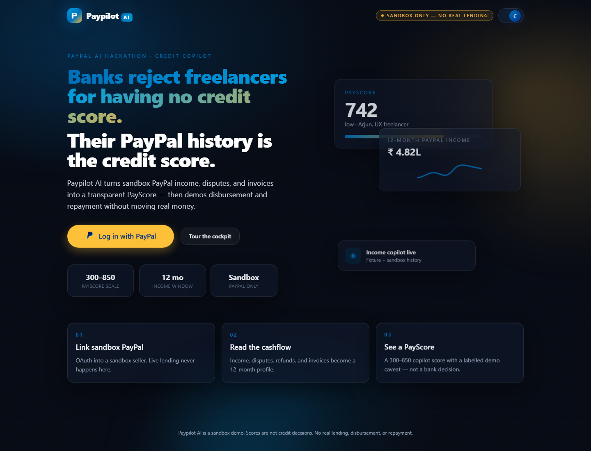

# Paypilot AI frontend

React 18 + Vite + Tailwind app for the Paypilot AI hackathon demo. It talks to the FastAPI service in `payscore/`.
The full design notes are in [`docs/FRONTEND_UI.md`](../docs/FRONTEND_UI.md).

## Run locally

1. Start the API from the repository root: `uvicorn payscore.api:app --port 8000`. See the root `README.md` for setup.
2. In `frontend/`, run `npm install`, then `npm run dev`.
3. Open http://localhost:5173 and choose **Try as Priya** or **Try as risky borrower**. No login is needed.

Vite proxies the API paths to port 8000, so no environment variables are needed locally. For a production build, set
`VITE_PAYSCORE_API_URL` to the API origin (see `.env.example`). PayPal login and sandbox checkout also need the PayPal
sandbox variables in the API's `.env`. Set `PAYSCORE_FRONTEND_URL=http://localhost:5173` on the API as well, so PayPal
login returns to `/auth/callback` and Income Passport PDFs link to the local verification page.

## Layout

```text
src/
  pages/              one component per route
  components/
    brand/            logo and wordmark
    landing/          landing-page pieces
    layout/           app shell, top bar, nav, persona switch
    ui/               shared building blocks (cards, buttons, metric cards)
    income/           AG Grid transaction feed (lazy-loaded)
    offer-guard/      PayPal Pay Later comparison
  context/            auth/session and theme providers
  lib/                API client, demo personas, motion presets
```

## Routes

| Route | Page |
|---|---|
| `/` | Landing page: PayPal login and the two demo entries |
| `/try/priya`, `/try/rohan` | Shareable links that open the demo as that persona |
| `/app` | Overview |
| `/app/income` | Income profile and transaction feed |
| `/app/score` | PayScore with TreeSHAP drivers |
| `/app/model-card` | Model card |
| `/app/passport` | Income Passport |
| `/app/negotiate` | Rule-based negotiation (simulated settlement) |
| `/app/offer-guard` | Loan offer check, injection guard, Pay Later comparison |
| `/app/copilot` | Approval-gated copilot |
| `/app/repay` | Repayment modes and payout status |
| `/app/cockpit` | AG Studio widgets |
| `/verify/income-passport/:token` | Public passport verification, no login |

## Demo limits

Everything uses synthetic personas and the PayPal sandbox. Nothing makes a real lending decision or moves real money.
Scores come from a model trained on synthetic data.


